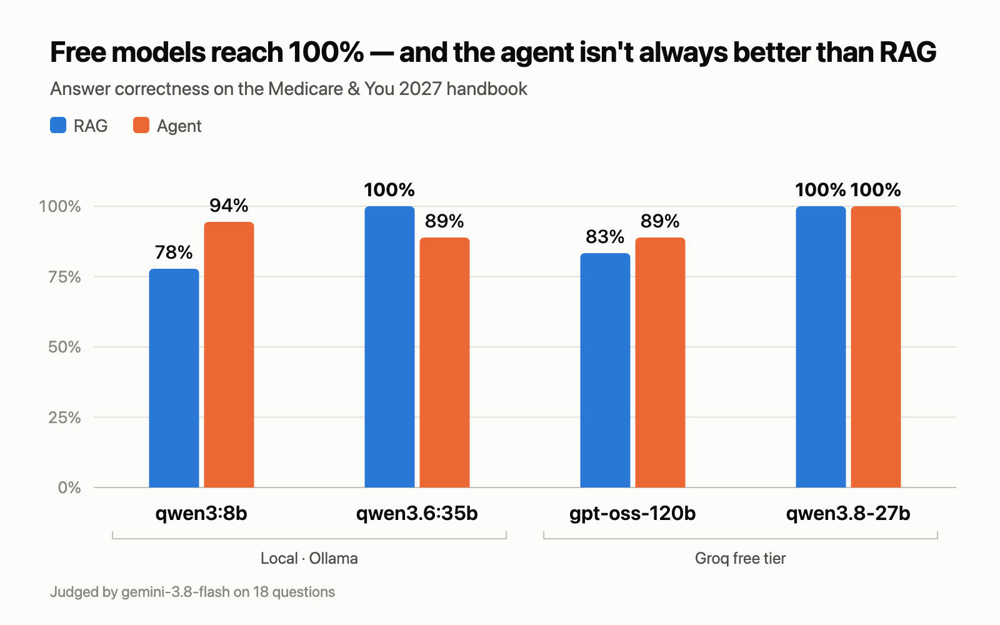

# policy-rag-agent

> An AI agent that answers questions about insurance policy documents with page-level citations — available as a web app and as an MCP server for Claude.


---

## The problem

Insurance documents are long, dense, and full of tables and multi-column layouts. Finding a clear answer to a simple question — *"Does this plan cover dental? If not, how do I add it?"* — often means scanning dozens of pages.

Generic chatbots make this worse: they answer confidently without saying where the answer came from, so you can't trust or verify them.

## What this project does

- **Answers questions in plain language**, grounded only in the source documents
- **Cites every answer** with the exact page number, so users can verify it
- **Handles multi-step questions** — the agent decides when to search again, read a full page, or combine results before answering
- **Works in two ways**:
  - a **web app** for end users
  - an **MCP server**, so Claude Desktop, Claude Code, or any MCP-compatible agent can use the same tools
- **Model-agnostic** — runs on Claude in production, or on a local open-source model via Ollama at zero cost

Source documents are public U.S. government publications (e.g. *Medicare & You*), downloaded by a script and not stored in this repo.

## Architecture

```
                    ┌──────────────────────────────┐
  PDF documents ──▶ │ Ingest: parse → chunk by     │
                    │ section (page metadata kept) │
                    └──────────────┬───────────────┘
                                   ▼
                          ┌─────────────────┐
                          │  Vector store   │  (Chroma; swappable)
                          └────────┬────────┘
                                   ▼
                    ┌──────────────────────────────┐
                    │ Tools                        │
                    │  • search_policy(query)      │
                    │  • get_page(page_number)     │
                    └───────┬──────────────┬───────┘
                            ▼              ▼
                ┌──────────────────┐  ┌──────────────────┐
                │ Agent            │  │ MCP server       │
                │ (tool-use loop)  │  │ (MCPServer)      │
                └───┬─────────┬────┘  └────────┬─────────┘
                    │         ▼                ▼
                    │  Streamlit web app  Claude Desktop / Code,
                    ▼                     other MCP clients
          ┌───────────────────────────────┐
          │       LLM client (port)       │
          └───┬───────┬───────┬───────┬───┘
              ▼       ▼       ▼       ▼
           Claude  Ollama   Groq   Gemini
            (API)  (local) (cloud) (cloud)
```

## Design decisions

**Chunk by section, not fixed length.** Fixed-size chunking often splits a clause in half, so the retrieved text loses its meaning. Chunks follow the document's own headings, and every chunk carries its page number.

**Tables are kept intact.** Coverage and cost tables are where most of the useful answers live, so they are extracted as whole units instead of being broken across chunks.

**Citations are required, not optional.** The agent is instructed to answer only from retrieved text and to cite page numbers. If the documents don't contain the answer, it says so instead of guessing.

**Tools are shared between the agent and the MCP server.** The same tool functions power both the web app and the MCP server, so behavior stays consistent.

**Ports and adapters for storage and models.** Both external dependencies sit behind interfaces, so the agent and tools never depend on a specific vendor:

- **Vector store** (`store/base.py`) — Chroma for local development; a pgvector adapter can be added without touching the agent or tools.
- **LLM** (`llm/base.py`) — one interface for chat with tool calling. The Claude adapter is used for production quality; the Ollama adapter runs an open-source model locally for free, offline development and testing. Switching is a single setting (`LLM_PROVIDER`). Groq and Google Gemini share one adapter for OpenAI-compatible endpoints (`llm/openai_compat_client.py`), so adding Groq took a base URL and a few lines of configuration.

This also makes it possible to run the same evaluation across models and compare them directly.

## Evaluation

Measured on *Medicare & You 2027* with 18 questions (`eval/questions.yaml`): 15 answered by the handbook, each with the pages that hold the answer and a reference answer written from them, plus 3 the handbook doesn't cover, which must be declined.



| Answering model | Mode | Answer correctness | Citation accuracy | Unsupported citations |
|---|---|---|---|---|
| qwen3:8b (Ollama, local) | RAG | 78% (14/18) | 100% | 6% |
| qwen3:8b (Ollama, local) | Agent | 94% (17/18) | 100% | 0% |
| qwen3.6:35b (Ollama, local) | RAG | **100% (18/18)** | 100% | 0% |
| qwen3.6:35b (Ollama, local) | Agent | 89% (16/18) | 87% | 6% |
| gpt-oss-120b (Groq) | RAG | 83% (15/18) | 100% | 0% |
| gpt-oss-120b (Groq) | Agent | 89% (16/18) | 87% | 0% |
| qwen3.8-27b (Groq) | RAG | **100% (18/18)** | 100% | 0% |
| qwen3.8-27b (Groq) | Agent | **100% (18/18)** | 100% | 0% |
| Claude (Anthropic API) | — | _TBD_ | _TBD_ | _TBD_ |

- **Answer correctness** — judged by `gemini-3.8-flash` against the reference answers; declining counts as correct only on the 3 out-of-scope questions (every run declined all 3, and none declined a question the handbook answers).
- **Citation accuracy** — share of answerable questions whose answer cites at least one page that holds the answer. Checked by code, no model involved.
- **Unsupported citations** — share of answers citing a page the system never retrieved. Also checked by code.
- Retrieval alone (`eval/run_retrieval_eval.py`, no LLM): the right page is the top result for 60% of questions and in the top 5 for 100% (MRR 0.76).

**What the numbers show**

- **The best model scored 100% in both modes** (`qwen3.8-27b` on Groq's free tier), and the local `qwen3.6:35b` matched it with RAG — so a free setup can answer this handbook reliably.
- **Bigger isn't automatically better.** `gpt-oss-120b`, the largest model tested, scored lowest after `qwen3:8b` with RAG. Its misses were incomplete rather than wrong: it answered the question but left out a key fact, such as that Medicare Advantage plans may cover dental care.
- **The agent didn't reliably beat RAG.** It helped the two models that were weaker with RAG (`qwen3:8b` 78% → 94%, `gpt-oss-120b` 83% → 89%), tied `qwen3.8-27b`, and hurt `qwen3.6:35b` (100% → 89%). Every model searched only about once per question (1.0–1.2 tool calls on average), and a second search happened on just a few questions. The typical failure: a reworded search for "referral to see a specialist" returned the glossary definition instead of the comparison table, and no model searched again — two of them then answered that a referral is generally required, which is wrong for Original Medicare.
- **The citation check catches real mistakes.** A model sometimes turns a cross-reference in the text ("go to pages 33–57") into a citation; those pages were never retrieved, so they are flagged rather than trusted.

**About the judge.** LLM judges disagree, so the same saved answers were graded by three judges (`--rejudge`). `gemini-3.8-flash` was the strictest and the one whose verdicts held up in a manual check of the disagreements; the local `qwen3.6:35b` agreed with it on 87% of verdicts and `gemini-3.5-flash-lite` on 83%, both mainly by passing answers that left out a key fact. With 15 answerable questions, one question is about 6 points, so treat small differences as noise.

Gemini wasn't evaluated as an answering model: its free tier allows 20 requests per model per day, and an agent run takes several requests per question. Groq's free tier (1,000 requests per day, 8,000 tokens per minute) was enough; when the token limit is hit, the client waits as long as Groq's `retry-after` header says and retries.

Run it with:

```bash
uv run python eval/run_eval.py                                   # answer with LLM_PROVIDER, Gemini judge
LLM_PROVIDER=groq GROQ_MODEL=qwen/qwen3.8-27b uv run python eval/run_eval.py  # a Groq model
uv run python eval/run_eval.py --judge ollama                    # free local judge (qwen3.6:35b)
uv run python eval/run_eval.py --rejudge                         # re-grade saved answers
OLLAMA_MODEL=qwen3.6:35b uv run python eval/run_eval.py          # evaluate another model
```

Saved answers and graded results are in `eval/results/`.

## Tech stack

- **Python 3.12**, managed with [uv](https://github.com/astral-sh/uv)
- **Claude API** (Anthropic) for reasoning and tool use
- **Ollama** for running open-source models locally during development
- **Groq** (OpenAI-compatible API) for hosted open models on a free tier
- **Google Gemini** (OpenAI-compatible API) as a hosted model and as the evaluation judge
- **PyMuPDF** for PDF parsing
- **Chroma** as the vector store
- **MCP Python SDK (`MCPServer`)** for the MCP server
- **Streamlit** for the web UI

## Quick start

```bash
git clone https://github.com/CHIEN-CHOU-WU/policy-rag-agent.git
cd policy-rag-agent

# Install dependencies
uv sync

# Configure the model
cp .env.example .env
```

Choose one model provider in `.env`. Ollama is the default, so it runs for free with no API key:

```bash
# Option A — local model via Ollama (default; free, runs offline)
LLM_PROVIDER=ollama
OLLAMA_MODEL=qwen3:8b

# Option B — Claude (best quality)
LLM_PROVIDER=anthropic
ANTHROPIC_API_KEY=your-key-here

# Option C — Google Gemini (free tier; also the evaluation judge)
LLM_PROVIDER=gemini
GEMINI_API_KEY=your-key-here

# Option D — Groq (free tier, fast hosted open models)
LLM_PROVIDER=groq
GROQ_API_KEY=your-key-here
```

For Option A, install [Ollama](https://ollama.com) and pull a model that supports tool calling:

```bash
ollama pull qwen3:8b
```

Then build the index and run the app:

```bash
# Download source documents and build the index
uv run python scripts/download_data.py
uv run python -m policy_rag.ingest

# Ask a question from the command line
uv run python -m policy_rag.ask "What does Part B cover?"           # RAG: search once, then answer
uv run python -m policy_rag.ask --agent "How do I add dental coverage?"  # agent: research with tools

# Launch the web app
uv run streamlit run src/policy_rag/app.py
```

To regenerate the demo GIF: `uv sync --group demo && uv run playwright install chromium`, then `uv run --group demo python scripts/record_demo.py`.

## Using it as an MCP server

The MCP server exposes the same `search_policy` and `get_page` tools the agent uses. Build the index first (`uv run python -m policy_rag.ingest`).

**Claude Code** — the repo ships a project `.mcp.json`, so opening this folder in Claude Code offers to enable the `policy-search` server. To use it from any other folder instead:

```bash
claude mcp add policy-search -- uv run --directory /path/to/policy-rag-agent python -m policy_rag.mcp_server
```

**Claude Desktop** — add to `claude_desktop_config.json` (if Claude Desktop can't find `uv`, use its full path from `which uv`):

```json
{
  "mcpServers": {
    "policy-search": {
      "command": "uv",
      "args": ["run", "--directory", "/path/to/policy-rag-agent", "python", "-m", "policy_rag.mcp_server"]
    }
  }
}
```

Then ask Claude something like *"Using the policy search tool, what does Medicare Part B cover for preventive care?"*

## Project structure

```
policy-rag-agent/
├── .mcp.json                 # registers the MCP server with Claude Code
├── docs/demo.gif             # recorded by scripts/record_demo.py
├── scripts/
│   ├── download_data.py      # fetch public source PDFs
│   └── record_demo.py        # drive the web app and record the demo GIF
├── src/policy_rag/
│   ├── config.py             # settings from environment / .env
│   ├── models.py             # shared data types (Chunk, SearchResult)
│   ├── ingest/
│   │   ├── __main__.py       # `python -m policy_rag.ingest` entry point
│   │   ├── parse.py          # PDF → text + page numbers
│   │   └── chunk.py          # section-based chunking
│   ├── store/
│   │   ├── base.py           # VectorStore interface (port)
│   │   ├── chroma_store.py   # Chroma implementation (adapter)
│   │   ├── page_store.py     # full page text for get_page (port + JSON adapter)
│   │   └── factory.py        # picks the adapters
│   ├── llm/
│   │   ├── base.py           # LLMClient interface (port)
│   │   ├── anthropic_client.py  # Claude adapter
│   │   ├── ollama_client.py     # Ollama adapter
│   │   ├── factory.py           # picks the adapter from LLM_PROVIDER
│   │   └── openai_compat_client.py  # Groq / Gemini adapter (OpenAI-compatible)
│   ├── retrieve.py           # search + format excerpts for the model
│   ├── rag.py                # answer with page citations, checked against sources
│   ├── tools.py              # search_policy / get_page, shared by agent and MCP server
│   ├── agent.py              # tool-use agent loop (any provider)
│   ├── ask.py                # `python -m policy_rag.ask [--agent]` entry point
│   ├── mcp_server.py         # MCP server exposing the tools
│   ├── evaluation.py         # answer judging (batched) and citation metrics
│   └── app.py                # Streamlit UI
├── eval/
│   ├── retrieval_questions.yaml  # questions with known answer pages
│   ├── run_retrieval_eval.py     # hit@k / MRR for retrieval (no LLM)
│   ├── questions.yaml            # questions with reference answers and pages
│   ├── run_eval.py               # end-to-end eval, RAG and agent modes
│   └── results/                  # saved results behind the table above
└── tests/
```

## Roadmap

- [x] M1 — Ingest: parse, chunk, and index documents with page metadata
- [x] M2 — Basic RAG with page citations, behind a pluggable LLM interface (Claude + Ollama)
- [x] M3 — Agent with `search_policy` and `get_page` tools
- [x] M4 — MCP server
- [x] M5 — Web UI, evaluation results, demo
- [x] M6 — Add a Groq adapter (Gemini landed in M5); run the same evaluation on every provider and publish the comparison

## Disclaimer

This is a demonstration project. Answers are generated by an AI model from public documents and are not insurance, legal, or medical advice. Always confirm details with the official source.

## License

[MIT](LICENSE)
