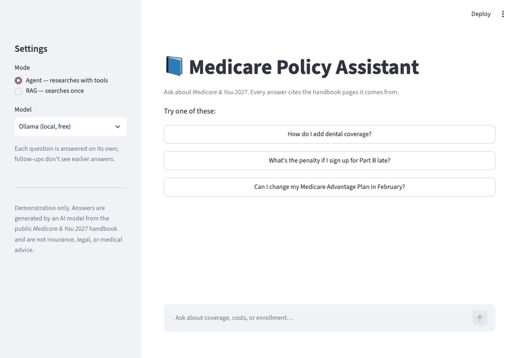

# policy-rag-agent

> An AI agent that answers questions about insurance policy documents with page-level citations — available as a web app and as an MCP server for Claude.

<!-- TODO (M5): replace with demo GIF -->


---

## The problem

Insurance documents are long, dense, and full of tables and multi-column layouts. Finding a clear answer to a simple question — *"Does this plan cover dental? If not, how do I add it?"* — often means scanning dozens of pages.

Generic chatbots make this worse: they answer confidently without saying where the answer came from, so you can't trust or verify them.

## What this project does

- **Answers questions in plain language**, grounded only in the source documents
- **Cites every answer** with the exact page number, so users can verify it
- **Handles multi-step questions** — the agent decides when to search again, read a full page, or combine results before answering
- **Works in two ways**:
  - a **web app** for end users
  - an **MCP server**, so Claude Desktop, Claude Code, or any MCP-compatible agent can use the same tools
- **Model-agnostic** — runs on Claude in production, or on a local open-source model via Ollama at zero cost

Source documents are public U.S. government publications (e.g. *Medicare & You*), downloaded by a script and not stored in this repo.

## Architecture

```
                    ┌──────────────────────────────┐
  PDF documents ──▶ │ Ingest: parse → chunk by     │
                    │ section (page metadata kept) │
                    └──────────────┬───────────────┘
                                   ▼
                          ┌─────────────────┐
                          │  Vector store   │  (Chroma; swappable)
                          └────────┬────────┘
                                   ▼
                    ┌──────────────────────────────┐
                    │ Tools                        │
                    │  • search_policy(query)      │
                    │  • get_page(page_number)     │
                    └───────┬──────────────┬───────┘
                            ▼              ▼
                ┌──────────────────┐  ┌──────────────────┐
                │ Agent            │  │ MCP server       │
                │ (tool-use loop)  │  │ (FastMCP)        │
                └───┬─────────┬────┘  └────────┬─────────┘
                    │         ▼                ▼
                    │  Streamlit web app  Claude Desktop / Code,
                    ▼                     other MCP clients
          ┌───────────────────┐
          │ LLM client (port) │
          └───┬───────────┬───┘
              ▼           ▼
          Claude API    Ollama
          (Anthropic)   (local)
```

## Design decisions

**Chunk by section, not fixed length.** Fixed-size chunking often splits a clause in half, so the retrieved text loses its meaning. Chunks follow the document's own headings, and every chunk carries its page number.

**Tables are kept intact.** Coverage and cost tables are where most of the useful answers live, so they are extracted as whole units instead of being broken across chunks.

**Citations are required, not optional.** The agent is instructed to answer only from retrieved text and to cite page numbers. If the documents don't contain the answer, it says so instead of guessing.

**Tools are shared between the agent and the MCP server.** The same tool functions power both the web app and the MCP server, so behavior stays consistent.

**Ports and adapters for storage and models.** Both external dependencies sit behind interfaces, so the agent and tools never depend on a specific vendor:

- **Vector store** (`store/base.py`) — Chroma for local development; a pgvector adapter can be added without touching the agent or tools.
- **LLM** (`llm/base.py`) — one interface for chat with tool calling. The Claude adapter is used for production quality; the Ollama adapter runs an open-source model locally for free, offline development and testing. Switching is a single setting (`LLM_PROVIDER`). Hosted free-tier providers (Groq, Google Gemini) are planned next, using their OpenAI-compatible endpoints.

This also makes it possible to run the same evaluation across models and compare them directly.

## Evaluation

<!-- TODO (M5): fill in after running eval -->

A set of test questions with known answers and source pages is kept in `eval/questions.yaml`. Each run measures:

| Model | Answer correctness | Citation accuracy (correct page cited) |
|---|---|---|
| Claude (Anthropic API) | _TBD_ | _TBD_ |
| Local model via Ollama | _TBD_ | _TBD_ |
| Groq (planned) | _TBD_ | _TBD_ |
| Google Gemini (planned) | _TBD_ | _TBD_ |

Run it with:

```bash
uv run python eval/run_eval.py                         # uses LLM_PROVIDER from .env
LLM_PROVIDER=ollama uv run python eval/run_eval.py     # or override per run
```

## Tech stack

- **Python 3.12**, managed with [uv](https://github.com/astral-sh/uv)
- **Claude API** (Anthropic) for reasoning and tool use
- **Ollama** for running open-source models locally during development
- **PyMuPDF** for PDF parsing
- **Chroma** as the vector store
- **MCP Python SDK (FastMCP)** for the MCP server
- **Streamlit** for the web UI

## Quick start

```bash
git clone https://github.com/johnson12440/policy-rag-agent.git
cd policy-rag-agent

# Install dependencies
uv sync

# Configure the model
cp .env.example .env
```

Choose one model provider in `.env`:

```bash
# Option A — Claude (best quality)
LLM_PROVIDER=anthropic
ANTHROPIC_API_KEY=your-key-here

# Option B — local model via Ollama (free, runs offline)
LLM_PROVIDER=ollama
OLLAMA_MODEL=qwen3:8b
```

For Option B, install [Ollama](https://ollama.com) and pull a model that supports tool calling:

```bash
ollama pull qwen3:8b
```

Then build the index and run the app:

```bash
# Download source documents and build the index
uv run python scripts/download_data.py
uv run python -m policy_rag.ingest

# Launch the web app
uv run streamlit run src/policy_rag/app.py
```

## Using it as an MCP server

**Claude Code:**

```bash
claude mcp add policy-search -- uv run --directory /path/to/policy-rag-agent python -m policy_rag.mcp_server
```

**Claude Desktop** — add to `claude_desktop_config.json`:

```json
{
  "mcpServers": {
    "policy-search": {
      "command": "uv",
      "args": ["run", "--directory", "/path/to/policy-rag-agent", "python", "-m", "policy_rag.mcp_server"]
    }
  }
}
```

Then ask Claude something like *"Using the policy search tool, what does Medicare Part B cover for preventive care?"*

## Project structure

```
policy-rag-agent/
├── scripts/
│   └── download_data.py      # fetch public source PDFs
├── src/policy_rag/
│   ├── ingest/
│   │   ├── parse.py          # PDF → text + page numbers
│   │   └── chunk.py          # section-based chunking
│   ├── store/
│   │   ├── base.py           # VectorStore interface (port)
│   │   └── chroma_store.py   # Chroma implementation (adapter)
│   ├── llm/
│   │   ├── base.py           # LLMClient interface (port)
│   │   ├── anthropic_client.py  # Claude adapter
│   │   ├── ollama_client.py     # Ollama adapter
│   │   └── openai_compat_client.py  # Groq / Gemini adapter (planned)
│   ├── retrieve.py
│   ├── agent.py              # Claude tool-use loop
│   ├── mcp_server.py
│   └── app.py                # Streamlit UI
├── eval/
│   ├── questions.yaml
│   └── run_eval.py
└── tests/
```

## Roadmap

- [ ] M1 — Ingest: parse, chunk, and index documents with page metadata
- [ ] M2 — Basic RAG with page citations, behind a pluggable LLM interface (Claude + Ollama)
- [ ] M3 — Agent with `search_policy` and `get_page` tools
- [ ] M4 — MCP server
- [ ] M5 — Web UI, evaluation results, demo
- [ ] M6 — Add Groq and Gemini adapters once the Ollama setup is stable; run the same evaluation on every provider and publish the comparison

## Disclaimer

This is a demonstration project. Answers are generated by an AI model from public documents and are not insurance, legal, or medical advice. Always confirm details with the official source.

## License

[MIT](LICENSE)
